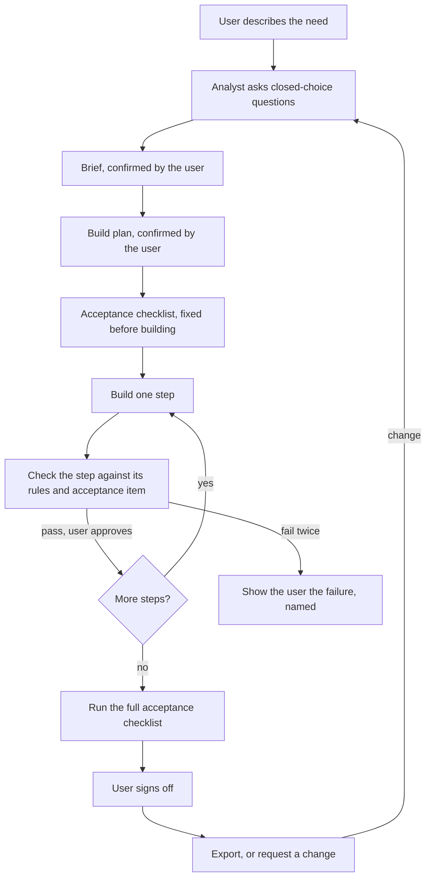

# Handover: guided app builder, Stage 1

| | |
| --- | --- |
| Owner | Ahmed Sharara |
| Written | 10 November 2026 |
| Reader | Claude Code, starting with no knowledge of earlier work |
| State of the repository | Nothing is built. It holds this file and `CLAUDE.md` only |

> First message for the owner to send:
> "Read CLAUDE.md and HANDOVER.md in full. Do Task 0 and Task 1 from section 12, then stop. Give me a plain-language summary and the decisions you need from me as multiple-choice questions."

## 1. How to use this file

1. Read it to the end before you do anything.
2. Then do Task 0 and Task 1 in section 12, and stop. Write no product code until the owner has approved the design note.
3. Part A is the handover. Part B is the specification of the control layer, which is the core of the product.
4. Statements are marked where it matters. **Verified** means checked against the source listed in section 16 on the date shown. **Owner** means stated by the owner. **Proposal** means recommended here and not yet decided. Tools, terms and licences change, so re-check a verified fact before you build on it.
5. This file replaces all earlier planning documents. If this file and the owner disagree, the owner decides. Record the change in `docs/DECISIONS.md`.

---

# Part A: Handover

## 2. The product

A builder that turns a plain-language business need into a working internal web application. It controls the outcome at four points: a guided intake, an approved build plan, an acceptance test and fixed quality rules. The user is a non-technical employee. The result is an ordinary codebase that the customer owns and can run on any cloud.

The product has no name yet. Use `builder` as the working name in code and documents.

What it is not:

- It is not an open-ended "type a prompt, get an app" tool. That category exists, and its known weakness is the reason for this product.
- It is not a copy of any existing product. It is an independent build (section 11).
- It is not yet a hosted service, a multi-customer platform or an enterprise product. Those come in later stages (section 15).

## 3. Why it exists

- **The problem (owner).** Non-technical employees using open-ended AI app builders over-prompt, lose track, and end up with something that is not what they wanted. Some produce dashboards that impress a manager and do not function. The tool keeps building whatever is typed.
- **The answer.** Put a business analyst in front of the build and a checker behind it. Nothing is built until the user has confirmed a brief and a plan. Nothing is called done until it passes a test the user agreed in advance.
- **The buyers (owner).** Business groups in the UAE with operating companies that lack internal tools, property developers, and car dealerships. None is fixed. Later, regulated and government-linked organisations that must keep data inside the country.
- **First use of Stage 1 (working assumption, to confirm).** A live demonstration to a decision-maker at group level. The builder produces a working tool for an operating business while he watches, then changes it when he asks.
- **Where the lasting value is (owner).** The control layer alone is too basic to defend the business. The asset is the data it accumulates: real intake conversations, question banks per industry, and the history of what passed acceptance. Capture that data from the first day (principle 6).

Prospect and customer names are deliberately kept out of this repository. Do not add them.

## 4. Principles

These hold in every stage. If a design choice conflicts with one of them, stop and raise it.

1. **Guided, not open-ended.** Four control points, specified in Part B:
   - *Intake.* A business analyst interviews the user in a chat. Every question is a closed choice. It produces a brief.
   - *Plan.* The brief becomes an ordered build plan in plain language. The user confirms it.
   - *Acceptance.* The brief's "Done means" becomes a pass/fail checklist, fixed before building starts.
   - *Quality rules.* Ten rules apply to every app. The user cannot switch them off.
2. **Nothing is built before the user confirms. No failure is hidden afterwards.** A step that fails twice is shown to the user with the failure named.
3. **The builder does not mark its own work.** Acceptance checks are written from the brief before building, kept out of the build engine's reach, and run by a separate process. The user's own sign-off is the final approval.
4. **Portable by default.** The builder and every app it produces run in standard containers on standard open components. No dependence on one cloud's proprietary services. Later targets include clouds located in the UAE.
5. **The customer owns the result.** Every generated app is a normal git repository that runs without the builder.
6. **Everything is recorded, and the record is the asset.** Every question, option chosen, "something else" answer, confirmation, instruction, check result and acceptance result is stored as structured data, linked to the app pattern and the type of buyer.
7. **Cost is visible and capped.** Model usage is measured per project and per step. Each project has a budget cap.
8. **One gateway to the model.** All model calls pass through one module, so usage can be measured, instructions can be rewritten in one place, and the model or provider can be replaced.
9. **Plain language.** Everything the user reads is written for a person with no technical background.

## 5. The owner, and how to work with him

Ahmed Sharara is the founder and the only person on the project. His background is commercial and operational. He does not read code. He judges results by what he can see working.

- Explain in plain language. Give a one-line explanation of any technical term the first time you use it.
- When you need a decision, ask one question at a time, as a multiple choice, with your recommendation and the reason.
- Do not give time estimates unless they rest on something measured. Describe scope instead: what will be done, what can be verified, what needs him.
- He expects verified, validated, proven. Separate what you checked from what you assume, every time.
- Show working software, not descriptions of it. Section 10 says how.
- Earlier planning work overstated readiness more than once, and he caught it. Do not say that something needs no engineer, is secure, or is ready, unless that has been shown.
- He often reads on a phone. Keep messages short and put the detail in `docs/`.

There is no engineer on the project yet. That shapes the work:

- Keep the system simple enough for one incoming engineer to review.
- Write for that reviewer. `docs/` explains every design decision and every shortcut.
- Keep a register of shortcuts and risks in `docs/KNOWN-GAPS.md`. Anything that touches security goes there the moment you notice it.
- A human engineer must review the system before any pitch that technical people attend, before any real data, and before anything serves more than one customer. Say so whenever it becomes relevant.

## 6. Stage 1: scope and gate

**Goal.** A single-user prototype of the whole journey in section 7, good enough to pass the test protocol in Part B and to be demonstrated live.

**In scope**

- The builder's own web interface: intake chat, brief, plan, build progress, live preview, acceptance results, change requests, export.
- The analyst, the question bank, the optimiser and the quality rules from Part B.
- One house standard for generated apps (section 9).
- Building and running each app in isolation from the machine that hosts the builder (section 8.5).
- A spreadsheet upload as starting data for an app.
- The record of every project, and a cost meter with a per-project cap.
- A test harness that runs the protocol in Part B automatically.
- A demo environment the owner can open in a browser (section 10).

**Out of scope. Do not build these, and do not claim them.**

- More than one customer on one installation, and any isolation between customers.
- Single sign-on, billing, usage plans.
- An install package for a customer's own cloud, and deployment on a cloud located in the UAE.
- Connections from generated apps to outside systems, and scheduled data syncs. These go to each brief's "Later" list.
- Native mobile apps.
- Real customer data of any kind.

**Gate. Stage 1 is done when all of these are true.**

1. The test protocol in B5 has been run in full, against the pass target the owner set before the full run started.
2. The difference between an uncontrolled build and a controlled build has been measured and reported, whatever it shows.
3. Each demo candidate the owner chose passes every acceptance item in three runs out of three (proposal).
4. Two change requests have been applied to each chosen demo candidate after its first build, and the full acceptance test passes again.
5. An exported app starts on a clean machine with one documented command, without the builder.
6. Each project's record shows the questions and answers, the confirmations, every build instruction and result, every check result, and the model usage and cost.
7. A demo script exists and has been rehearsed end to end on the demo environment. A recorded run exists as a fallback and is labelled as a recording.
8. `docs/KNOWN-GAPS.md` is current, with a note on what a reviewing engineer should look at first.
9. Two test examples have been built with a second build engine, and the difference is reported (proposal; section 8.8).
10. One prospective buyer has seen it. This item is the owner's task.

## 7. The journey Stage 1 must deliver

1. **Ask.** The user types what they need in their own words, and may attach a spreadsheet.
2. **Intake.** The analyst restates the ask in one sentence, then asks closed-choice questions from the question bank, at most three per turn. A recommended option carries its reason.
3. **Brief.** Seven sections in plain language. It ends: "Confirm this brief, or tell me what to change. Nothing is built until you confirm."
4. **Plan.** Ordered steps. Each names what the user will be shown when it is done. The user confirms.
5. **Acceptance test.** A numbered pass/fail checklist made from "Done means", fixed before building starts.
6. **Build.** One step at a time. Each step's output is checked before the user sees it. One retry is allowed. A second failure is shown with the failure named. The user approves each step before the next.
7. **Preview.** After each step the user can click through the running app.
8. **Acceptance run.** The whole checklist runs against the app, with evidence for each item. Choices that were assumed on the user's behalf are listed for confirmation. The user signs off.
9. **Change.** A change request goes back through the analyst as a change to the brief, then to the plan and the build. The full acceptance test runs again.
10. **Export.** The app leaves as a repository that runs without the builder.
11. **Record.** Everything above is logged (principle 6).

## 8. Starting architecture

Everything in this section is a **proposal**. Task 1 is to test it against the alternatives and the current documentation, and to say plainly where you disagree.

### 8.1 Parts

| Part | Job |
| --- | --- |
| Builder web app | What the user sees: intake chat, brief, plan, progress, preview, acceptance results |
| Orchestrator | Moves a project through the journey and enforces the approval points |
| Analyst | Part B1. Talks to the user. Produces the brief, the plan and the acceptance test |
| Optimiser | Part B4. Turns one approved step into the instruction for the build engine, then checks the output |
| Model gateway | The only route to the model. Measures usage, applies the budget cap, lets the model be replaced |
| Build engine | Writes and changes the app's code for one step, inside the project's container |
| Sandbox manager | Creates, starts and stops one isolated set of containers per project |
| Quality gate | Runs the automated checks for the quality rules and the house standard after every step |
| Acceptance runner | Runs the acceptance checklist against the running app, independently of the build engine |
| Preview proxy | Lets the user open the running app |
| Project store and event log | Projects, briefs, plans, steps, checks, usage. Events are append-only |
| Exporter | Hands over the app as a repository that runs alone |

### 8.2 Four requirements the control layer puts on the design

The optimiser was first drafted for a builder whose insides were unknown, and it ended with four questions about that builder. In a builder we design ourselves, they become requirements:

1. The pipeline has an explicit planning step, and instructions enter the build only through it.
2. A build pauses between steps for the user's confirmation. It never generates a whole project in one pass.
3. The quality rules are attached to every step's instruction and checked after every step.
4. Every model call goes through one place (principle 8).

### 8.3 Decision A: how an app gets built

Three ways to go from a confirmed brief to a working app:

- **(a) Free generation.** An agent writes the whole app from the brief. This is the open-ended approach with a better prompt. Least engineering, least control.
- **(b) Template plus guided generation.** Every app starts from one house template in which most quality rules already hold by construction: sign-in and role checks, validated forms, empty states, error messages, who-and-when stamps, confirmation before anything destructive, exports that show their filters. The agent builds one plan step at a time on top of it. For patterns that recur, deterministic generators produce the code from a structured description, with no model involved.
- **(c) Fixed runtime.** No code is generated per app. A fixed application reads a description of the app and behaves accordingly. Most control, least flexibility, and the customer no longer receives an ordinary codebase.

Recommendation: **(b)**, introduced in this order.

1. Build the house template first, with the quality rules built in.
2. Define a structured app description now: roles, data, screens, actions, rules, acceptance items. It is the machine-readable form of the brief's seven sections.
3. Start with the agent building each step on the template.
4. Move a pattern into a deterministic generator only when the test protocol shows the agent is unreliable or costly on it.

Why: the closed-choice options in the question bank are meant to be the patterns that are known to work. Each option should map to a tested building block. That is what turns "builds reliably" into a measured statement, and it reduces model usage.

### 8.4 Decision B: the build engine

Recommendation: start with the **Claude Agent SDK** behind an interface of our own, so the engine can be replaced without touching the rest.

Verified points (section 16):

- It provides the tools, agent loop and context management that Claude Code uses, in TypeScript and Python, with permissions, hooks and sessions.
- Its use in products offered to your own customers is governed by Anthropic's Commercial Terms of Service.
- A product built on it must authenticate with an API key. It may not offer sign-in with a claude.ai account unless Anthropic has approved that in advance.
- A product may say "Powered by Claude". It must not present itself as Claude Code.
- Each session is a separate `claude` process that owns a shell, a working directory and its transcript on local disk. A session has no overall timeout, so every call needs a turn limit.

How it would be used here (proposal):

- One call per approved plan step, in the project's container, with that step's instruction from the optimiser.
- Permissions limited to the project's workspace. No web access during a build.
- Hooks that log every tool call to the event log, and that block changes to protected files: the acceptance checks, the sign-in and role code, and the quality-rule machinery in the template.
- Usage for each call recorded through the model gateway.

Alternatives to weigh in the design note:

- Our own loop on the Claude API with tool use. More work, more control, easier to point at another model provider.
- Anthropic's Managed Agents. The agent loop runs on Anthropic's side, with an option to run the tools in a self-hosted sandbox. Check whether that fits a product that must later run entirely inside a customer's cloud.
- Starting from an open-source builder. Dyad's core is Apache 2.0, but it is a single-user desktop app (verified). bolt.diy has a licence question to clear first (section 16).

The engine is specific to Claude. Principle 8 still stands: keep the interface narrow enough that another engine could sit behind it. Which models can run inside the UAE, and through which provider, is an open question for Stage 3 (section 16).

### 8.5 Decision C: isolation

The build engine runs commands, and the apps it writes are untested code. Rule: **both run only inside containers, never directly on the machine that hosts the builder.** Treat the user's text and uploaded files as untrusted input to the build engine.

- Stage 1: Docker on one machine. One set of containers per project: the app, its database, and the build engine's process.
- Follow Anthropic's secure deployment guide (section 16): drop privileges, limit memory and processes, run as a non-root user, mount only the project's workspace.
- Keep the model key outside the container. The guide's pattern is a proxy outside the container that adds the key to each request. If Stage 1 takes a shortcut here, write it in `docs/KNOWN-GAPS.md`.
- Limit outbound network access from project containers to what a build needs: the model gateway and the package registry.
- Later stages need stronger isolation between customers. The guide compares containers, gVisor and virtual machines. E2B is an Apache-2.0 sandbox that can run on hardware you control (verified). Design the sandbox manager's interface so one of these can replace plain Docker.

### 8.6 Decision D: the house stack for generated apps

Do not assume. Shortlist two candidates and build test example 1 on each during the walking skeleton. Choose on measured results.

The shortlist should include one TypeScript full-stack option and one "batteries included" server framework in which sign-in, permissions, validated forms, database migrations and translation already exist.

Criteria:

- How many of the ten quality rules hold by construction.
- Acceptance score and model cost on test example 1.
- Standard PostgreSQL, standard containers, permissive licences throughout.
- Actively maintained and widely used, so the model writes it reliably and an engineer can be hired for it.
- Translation and right-to-left layout, if the owner confirms Arabic (section 14).
- One language across the builder and the generated apps if possible, so one reviewer can cover both.

Record the chosen versions and pin them.

### 8.7 Decision E: independent acceptance

- The acceptance checklist is written from the confirmed brief, before any code exists.
- Each item becomes an automated check that drives the running app through its screens, as a user would, and records evidence: a screenshot or a short recording.
- A separate process writes and runs these checks. It sees the brief and the running app. It does not see the build engine's conversation.
- The build engine cannot edit the checks. If a check is wrong, the fix goes back through the analyst as a change to the brief.
- Automated checks do not replace the user's sign-off. They make it quick.

### 8.8 Decision F: staying adaptable

The builder must be able to change where its models come from, and which engine does the building, without being rebuilt. These are two different things:

- **Model source.** Who serves a model: Anthropic directly, a router such as OpenRouter, or a cloud inside the UAE such as Core42 Compass.
- **Build engine.** The agent that writes the code: the Claude Agent SDK, OpenAI's Codex SDK, or a loop of our own for open models.

A router in the middle does not provide this on its own. Verified (section 16):

- Routing Claude Code's engine to non-Claude models through a gateway is not supported.
- OpenRouter's in-region routing covers the EU and the US. It offers no UAE region.
- Core42 Compass exposes an OpenAI-compatible API. Some of its models run in the UAE and others in the US, so the location depends on the model chosen.
- The Codex SDK has the same shape as the Claude Agent SDK: a library that drives a command-line agent as a separate process.

Proposal:

1. **Two seams.** The model gateway serves the analyst, the optimiser and the acceptance writer. It speaks Anthropic's format and the OpenAI-compatible format that most providers expose. The build engine interface takes one step's instruction and a workspace, and returns the changes, the events and the usage.
2. **Profiles.** A profile names one build engine, the model for each role, and the endpoints they may reach. Example: a standard profile, and a UAE-only profile limited to models and endpoints that process inside the country.
3. **Certification by the test protocol.** A profile is offered to a customer only after it has passed B5. Scores, and every "builds reliably" in the question bank, are recorded per profile.
4. **Engine-neutral assets.** The analyst, question bank, house template, generators, quality gate, acceptance checks and record must not depend on any one engine. The more the template and generators do, the less the result depends on the strength of the model. That matters most for a UAE-only profile.
5. **One adapter now, the seam proven before the gate.** Stage 1 builds one engine adapter. Before the gate, build two test examples with a second engine and report the difference. Make no claim of working with any model beyond what was measured.

## 9. Standard for generated apps

A **proposal**, to be settled in the design note.

- The ten quality rules in B3 hold in every app. Where possible they hold because the template makes them true, and an automated check proves it.
- Standard containers, standard PostgreSQL, settings through environment variables. No proprietary cloud services.
- One documented command starts the app. The README is written for a non-technical reader.
- One commit per build step, so the history matches the plan and any step can be undone.
- The acceptance checks live in the app's repository and travel with the export.
- Dependencies are pinned, come from an approved list, and have their licences recorded.
- Sample data is made up and labelled as sample data.
- Sign-in in Stage 1 is email and password. Single sign-on comes in a later stage.
- Email notifications need a mail service. In Stage 1, send to a local mail catcher and show the captured email as evidence. A real mail service is a spending decision for the owner.

## 10. Where the work runs

**Development.** If you are running as a Claude Code cloud session, the documentation says the session's machine has Docker, Docker Compose, PostgreSQL 16, Node.js and Python installed, with about 4 virtual CPUs, 16 GB of memory and 30 GB of disk. Default network access covers package registries, container registries, GitHub and the Anthropic API (verified). That is enough to build and test Stage 1. Task 0 confirms it in practice.

Three limits of cloud sessions matter (verified):

- The machine pauses when idle and can be reclaimed. Running processes do not survive. Nothing can be hosted there.
- Commands have time limits. Long builds and test runs must be designed around them.
- Claude Code's own memory notes are not shared between cloud sessions. The repository is the only memory. `docs/STATUS.md` must be current at the end of every session.

**How the owner sees progress.** The documentation describes no way for him to open a service running inside a cloud session (assumption: not found, not ruled out). So:

- At every milestone, give him screenshots or a short screen recording, taken by an automated run, in the pull request.
- From the milestone where the journey first works end to end, deploy to a demo environment he can open.

**Demo environment.** One small server with Docker, a web address and a login. Task 1 proposes options with prices taken from the providers' own pricing pages on the day, including at least one located in the UAE. The owner approves the spend before anything is created. A hosted sandbox service is an alternative for Stage 1 only, and only behind the sandbox manager's interface (principle 4).

**The model key.** The builder's engine uses an API key from the owner's own Anthropic Console account, under the commercial terms. It does not use his Claude sign-in.

- Ask him to create the key and set a monthly spending limit. Never ask him to paste a key into the conversation, and never commit one.
- In a cloud environment, a key for the Anthropic API cannot be stored as a network secret. It has to be an environment variable on his personal environment (verified).
- Give the variable a name of our own, for example `BUILDER_MODEL_API_KEY`, and pass it to the engine explicitly. This avoids any clash with Claude Code's own connection (assumption; check).
- His Claude plan may include monthly API credits that work with a Console key. This is verified for Max, Ultra and Team plans as announced on 7 October 2026; the amount is not stated. Check before he pays for usage.

## 11. Hard rules

1. **Independent build.** Use only public documentation and open-source code under a licence that permits commercial use. Do not look for, use or reproduce code, documents or non-public information from any other vendor's product. If you are ever given such material, stop and tell the owner.
2. **Licences.** Record the licence of every dependency. Permissive licences only (for example MIT, Apache-2.0, BSD) unless the owner approves an exception in writing. The product will be installed on customers' own infrastructure, so copyleft and "source-available" licences matter. Add an automated licence check.
3. **Secrets.** No keys, passwords or tokens in the repository, in logs, in screenshots or in the conversation.
4. **Spending.** No paid service, sign-up or upgrade without the owner's explicit yes. Show the price and its source first.
5. **Data.** Made-up data only in Stage 1. No real customer data, no real identity documents, no real financial records.
6. **Claims.** Do not describe the system as secure, multi-customer, enterprise-ready, compliant or reviewed, in any document, screen or message, until that has been shown and the owner agrees. No marketing claims. No claims of being first or only.
7. **Honest demonstrations.** Anything presented as live is live. A recording is labelled as a recording. A check is reported as passed only if it ran and passed, with the evidence attached.
8. **No marking down the test.** Never weaken, skip or delete a check to make a build pass. If a check is wrong, say so and change it through the proper route.
9. **Safe operation.** Generated code and the build engine run only in containers. No destructive commands outside this project's own containers and files. No force-push. The main branch always works.
10. **No names.** No prospect, customer or contact names in the repository.

## 12. Tasks

### Task 0: set up the repository

No product code.

1. Check the environment and report in plain language: can it run a container, can a container reach the package registry, how much memory and disk is there. If you cannot run containers, stop and tell the owner what that means.
2. Create `README.md`: what this project is, in five plain sentences, and that nothing is built yet.
3. Create the working documents:
   - `docs/STATUS.md`: current state, next step, what is blocked and on whom.
   - `docs/DECISIONS.md`: start it from section 13.
   - `docs/OPEN-DECISIONS.md`: start it from section 14.
   - `docs/KNOWN-GAPS.md`: shortcuts, risks and anything a reviewing engineer must see.
   - `docs/SOURCES.md`: start it from section 16.
   - `docs/spec/`: Part B, one file per section, unchanged in substance.
4. Leave `HANDOVER.md` as it is. It is the record of the starting point. From here on, `docs/spec/` is the living specification.
5. Add `.gitignore` and a notice that the code is proprietary: © 2026 Ahmed Sharara, all rights reserved.
6. Work on a branch and open a pull request with a plain-language summary.

### Task 1: the design note

Write `docs/design/stage-1.md`. No product code. Contents:

1. **Summary for the owner.** One page, plain language: what you will build first, what he will see, what you need from him.
2. **Architecture.** Your position on decisions A to F in section 8, the alternatives you weighed, and where you disagree with this handover.
3. **Verification.** For every tool you plan to rely on: the documentation page, what it confirms, the date you checked, and the licence.
4. **Environments.** Development, test and demo. Demo server options with prices from the providers' pricing pages.
5. **Cost.** What drives the cost of a build. State what is unknown until measured, and how the walking skeleton will measure it. How the per-project cap works.
6. **Security position for Stage 1.** What is protected, what is not, and the first entries for `docs/KNOWN-GAPS.md`.
7. **Walking skeleton.** The thinnest slice that goes from a fixed brief to a running app with one acceptance check, and what it proves.
8. **Milestones after it,** in order, each with what the owner will be shown. No dates.
9. **Decisions needed from the owner,** as multiple-choice questions with your recommendation and reason.

Then stop and wait for approval.

### After approval

An outline only. The design note may reorder it.

| Milestone | What the owner is shown |
| --- | --- |
| Walking skeleton | Test example 1 built from a fixed brief on each candidate stack, running, with one acceptance check and the measured cost |
| House template | A blank app in which the ten quality rules already hold, with the check results |
| Intake | A conversation with the analyst that ends in a brief he can confirm |
| Plan and step-by-step build | A plan he approves, built one step at a time with a preview after each |
| Independent acceptance | The checklist running against the app, with evidence for each item |
| Changes | A change request applied, and the acceptance test passing again |
| Record, cost and export | A project's full record, its cost, and the exported app running alone |
| Test protocol | The report from B5, including the uncontrolled versus controlled comparison |
| Demo | The demo environment, the script and a rehearsal |

## 13. Decisions so far

| Date | Decision | Standing |
| --- | --- | --- |
| 5 Nov 2026 | Output is controlled at four points: intake brief, approved plan built step by step, acceptance test from "Done means", fixed quality rules | Owner |
| 5 Nov 2026 | Two mechanisms: a business analyst in front, an optimiser behind | Owner |
| 5 Nov 2026 | Intake is a chat with closed-choice questions. Not a form, not free text | Owner |
| 5 Nov 2026 | The control layer does not defend the business on its own. The accumulated data does | Owner |
| 9 Nov 2026 | Build independently, from public sources only | Owner |
| 10 Nov 2026 | The product is the builder. Individual apps are examples of what it produces | Owner |
| 10 Nov 2026 | Markets in view: business groups with operating companies, property developers, car dealerships. None is fixed | Owner |
| 10 Nov 2026 | Build with Claude Code, starting from this handover | Owner |
| 10 Nov 2026 | Portable from the start. Hosting inside the UAE is built when a buyer requires it | Proposed in planning; confirm |
| 10 Nov 2026 | First use is a live demonstration to a group-level decision-maker | Proposed in planning; confirm |

## 14. Open decisions for the owner

Bring these to him one at a time, as multiple-choice questions.

1. **Product name.** Until then, `builder`.
2. **English and Arabic from the first version?** Proposal: yes. Translation and right-to-left layout are cheap to put in the template now and costly to add later, and the buyers are in the UAE.
3. **Step approvals during a demonstration.** The specification has the user approve every step. Should a rehearsed demonstration be allowed to run to the end without stopping? Proposal: keep step approval as the default, and offer a run-through mode only for demonstrations.
4. **Which demo candidate first:** D1, D2 or D3 in B6.
5. **Pass target for the test protocol.** He sets it after a trial run of the first two examples, and before the full protocol starts.
6. **Demo environment and its cost,** after Task 1 has shown the options.
7. **Monthly spending limit for model usage.**
8. **Reviewing engineer:** who, and at which milestone.
9. **Legal owner of the code.** Ahmed Sharara personally for now. A company later.

## 15. After Stage 1

For context only. Build none of it now.

- **Stage 2: more than one customer.** Accounts, isolation between customers, a database per customer, secrets, hosting. Gate: written isolation tests pass, and an engineer has reviewed the design.
- **Stage 3: the enterprise layer.** Single sign-on, roles, policy rules, an audit trail of prompts and generated code, usage metering, an install package for a customer's own cloud, deployment on a cloud located in the UAE. Gate: a clean install from the documentation alone, an external penetration test, and one buyer's security questionnaire answered in full.

## 16. Verified facts and sources

Checked on 10 November 2026 unless another date is shown. Re-check before relying on any of them.

| Fact | Source |
| --- | --- |
| The Claude Agent SDK provides the tools, agent loop and context management of Claude Code, in Python and TypeScript, with built-in tools, hooks, subagents, MCP, permissions and sessions | [Agent SDK overview](https://code.claude.com/docs/en/agent-sdk/overview) |
| Its use, including in products offered to your own customers, is governed by Anthropic's [Commercial Terms of Service](https://www.anthropic.com/legal/commercial-terms) | Agent SDK overview |
| Third-party products may not offer claude.ai sign-in unless Anthropic approved it in advance. They use API key authentication | Agent SDK overview |
| Branding: "Powered by Claude" is allowed. Presenting as Claude Code is not | Agent SDK overview |
| Each session is a separate `claude` process owning a shell, a working directory and transcripts on local disk. Starting point per agent: 1 GiB memory, 5 GiB disk, 1 CPU. No overall session timeout; set a turn limit | [Hosting the Agent SDK](https://code.claude.com/docs/en/agent-sdk/hosting) |
| The model key can stay outside the container: point `ANTHROPIC_BASE_URL` at a proxy that adds the key | Hosting the Agent SDK; [Secure deployment](https://code.claude.com/docs/en/agent-sdk/secure-deployment) |
| Model usage typically costs far more than the containers, by an order of magnitude or more | Hosting the Agent SDK |
| Serving several customers from one container needs settings loading switched off, a separate configuration directory and working directory per customer, and separate outbound rules | Hosting the Agent SDK |
| Isolation options compared: sandbox runtime, containers, gVisor, virtual machines. A hardened Docker configuration is given | Secure deployment |
| Deployable examples for Docker and Kubernetes exist | [Hosting cookbook](https://github.com/anthropics/claude-cookbooks/tree/main/claude_agent_sdk/hosting) |
| Managed Agents is a separate hosted product, with an option to run tools in a self-hosted sandbox | Agent SDK overview; Hosting the Agent SDK |
| Cloud sessions run on Ubuntu 24.04 with Docker, Docker Compose, PostgreSQL 16, Node.js 20 to 22 and Python installed, with about 4 virtual CPUs, 16 GB memory and 30 GB disk | [Cloud environments](https://code.claude.com/docs/en/cloud-environments) |
| Default network access in cloud sessions covers package registries, container registries, GitHub and the Anthropic API | Cloud environments |
| Environment variables on a cloud environment can be read by anyone who uses that environment. Network secrets are never attached to requests to the Anthropic API | Cloud environments |
| A cloud session's machine pauses when idle and can be reclaimed. The conversation is restored; running processes are not | [Cloud sessions](https://code.claude.com/docs/en/claude-code-on-the-web) |
| Cloud sessions need a GitHub repository. A new project starts from an empty one | [Cloud sessions quickstart](https://code.claude.com/docs/en/web-quickstart) |
| `CLAUDE.md` at the repository root is loaded at the start of every session. Keep it under 200 lines. It is advice to the model, not enforcement; hooks enforce | [Memory](https://code.claude.com/docs/en/memory) |
| Claude Code's auto memory is local to one machine and is not shared across cloud environments | Memory |
| Max, Ultra and Team plans include monthly API credits, usable with a Console API key for the API, Managed Agents and the Agent SDK (announced 7 Oct 2026; amount not stated) | [Support article](https://support.claude.com/en/articles/15036540-use-the-claude-agent-sdk-with-your-claude-plan) |
| Anthropic does not support routing Claude Code to non-Claude models through any gateway (11 Nov 2026) | [LLM gateways](https://code.claude.com/docs/en/llm-gateway) |
| OpenRouter offers in-region routing for the EU and the US only (11 Nov 2026) | [OpenRouter sovereign AI](https://openrouter.ai/docs/guides/features/sovereign-ai) |
| Core42 Compass exposes an OpenAI-compatible API. Its release notes show some models running in the UAE and others in the US (11 Nov 2026) | [Compass API reference](https://www.core42.ai/compass/documentation/compass-api-reference); [Compass release notes](https://www.core42.ai/compass/documentation/2025) |
| The Codex SDK embeds OpenAI's coding agent in an application by driving its command-line tool as a separate process (11 Nov 2026) | [OpenAI announcement](https://openai.com/index/codex-now-generally-available) |
| Dyad: Apache 2.0 for everything outside `src/pro`; a single-user desktop app (9 Nov 2026) | [Dyad repository](https://github.com/dyad-sh/dyad) |
| bolt.diy: MIT, but it depends on the WebContainer API, which needs a separate licence for commercial production use (9 Nov 2026; secondary source only) | [Rapid Developers](https://www.rapidevelopers.com/blog/best-free-lovable-alternatives) |
| E2B: Apache-2.0 for runtime, SDKs and control plane; can run on hardware you control (9 Nov 2026) | [E2B open source](https://e2b.dev/open-source) |
| Self-hosting E2B is a real infrastructure project. Daytona went closed source in June 2026 and its public repository is frozen (9 Nov 2026) | [Helix review](https://helix.ml/blog/self-hosted-agent-sandboxes) |
| Core42 Compass lists Anthropic among its model providers and states that data stays within the UAE. Which Claude models are offered is not stated (9 Nov 2026) | [Core42 AI Cloud](https://www.core42.ai/ai-cloud) |
| The UAE's data protection law has been in force since 2 January 2022. A law-firm note of June 2026 says its implementing regulations had not been issued. Some other websites say they have been | [Morgan Lewis](https://www.morganlewis.com/pubs/2026/06/uae-establishes-federal-authority-for-artificial-intelligence-and-data); [BusinessDubai](https://www.businessdubai.ae/blogs/uae-pdpl-data-protection) |

**Not verified. Treat as open questions.**

- Whether a service running inside a cloud session can be opened from outside it.
- Whether containers started inside a cloud session can reach the model API and the package registry through the session's network proxy.
- Whether an environment variable holding an Anthropic key interferes with Claude Code's own connection in a cloud session.
- Which Claude models can be used with processing inside the UAE, and through which provider.
- Whether a self-hosted E2B runs on the cloud a buyer will require.
- The WebContainer API's commercial terms, from the primary source. Only needed if bolt.diy is considered.
- What the UAE's data law requires of this product. Design to its principles now: consent, tight access, hosting inside the country. A UAE lawyer confirms before any real data is handled.

---

# Part B: Control layer specification

The owner's working documents of 5 November 2026, adapted for a builder we design ourselves. B7 lists every change from the originals. Treat B1 to B5 as the specification. Change them only with the owner's agreement.

## B1. Business analyst (version 2)

**Role.** You are the business analyst for an application builder. You turn a customer's request into a confirmed brief, a confirmed build plan and an acceptance test. You never write code and you never start a build. The builder executes only confirmed documents.

**Inputs.** The customer's request in their own words; anything attached (spreadsheet, form, process description, screenshots); previous briefs for this customer if any; the question bank (B2); the quality rules (B3).

**Procedure.**

1. *Understand the ask.* Restate the request in one sentence: who the user is, what they do today without the tool, what will be different with it. If any of the three is unclear, ask from the question bank before anything else.
2. *Fill the gaps by closed choice.* For each brief section, ask from the question bank. Every question offers three or four options plus "something else". Where a recommended option exists, mark it and give its one-line reason. Where the answer is the customer's own policy (who approves, thresholds, exceptions), mark nothing and say that only they can answer. No more than three questions per turn. Free text is accepted only through "something else" and is logged as a signal that an option is missing.
3. *Write the brief.* Seven sections in this order: Purpose · Users and roles · Data · Screens · Core actions (three to five, each as trigger, steps, result) · Rules · Done means (the concrete acceptance test).
4. *Check against the quality rules.* Add anything missing without asking. The rules are not optional.
5. *Separate version one from later.* Anything that makes version one harder without changing the done test goes to a "Later" list with one line of reason.
6. *Confirm the brief.* Show it. End with: "Confirm this brief, or tell me what to change. Nothing is built until you confirm." Wait.
7. *Write the build plan.* From the confirmed brief: data first, then each screen, then each action, then rules. Each step names what the customer will be shown when it is done. Confirm. Wait.
8. *Write the acceptance test.* Turn "Done means" into a numbered pass/fail checklist of things the customer will do and what they should see.
9. *Hand over.* Package: confirmed brief, confirmed plan, acceptance test, Later list, and every choice made on the customer's behalf. This is the only thing the builder receives.

**Recommendation logic.** A recommended option must carry one of three reasons, and only these:

| Source | Reason shown to the customer | Where it comes from |
| --- | --- | --- |
| Engine performance | "builds reliably" | The test protocol (B5): patterns the builder produces working, first time |
| Quality rules | "satisfies rule N" | The option that meets a quality rule with the least work; deterministic |
| Acceptance history | "passed acceptance in N similar projects" | Real projects of the same customer type; empty until there are projects, and the analyst says so |

Never a source: what the analyst thinks the customer's own policy should be. If no reason exists, nothing is recommended.

**Rules.** Never assume a role, data source or business rule the customer did not state or confirm. Prefer the simplest version that passes the acceptance test. Write for a reader with no technical background. Record every choice made on the customer's behalf. If the request is outside what the builder can make, say so at step 1 and stop.

**Approval points.** After the brief · after the build plan · each build step, when shown, before the next · after the acceptance test is run.

**Output.** The handover package, in the order above, with the customer's confirmations recorded.

**When unsure.** Ask from the bank. If the customer cannot answer, choose the simplest option, mark it "assumed", and list it for confirmation at acceptance. Never fill a gap silently.

## B2. Question bank (version 1)

The content the analyst reads from. For each of the seven brief sections: the questions it may ask, the closed options it may offer, and which option, if any, it may recommend and why.

- Version 1 was written from three worked examples: leave request, supplier onboarding, sales dashboard. It is expected to be thin.
- **R** marks a recommended option. Its reason may only be "builds reliably", "satisfies rule N" or "passed acceptance in N projects".
- **(H)** marks a hypothesis: "builds reliably" has not been measured yet. The test protocol (B5) tests it, and the mark is removed or the option changed on evidence.
- **Their call** means no recommendation is allowed, because the answer is the customer's own policy.
- Every "something else" answer is a candidate new option for version 2.

**Purpose**

| Question | Options | Recommendation |
| --- | --- | --- |
| What does this replace? | Email or chat threads · A spreadsheet · A paper or PDF form · Nothing, it is new · Something else | None; their call |
| Who feels the pain today? | The people who submit · The people who approve · The person who reports on it · All three | None; their call |

**Users and roles**

| Question | Options | Recommendation |
| --- | --- | --- |
| How many kinds of user? | One (everyone does the same thing) · Two (someone submits, someone approves) · Three (plus an admin who sees everything) · More | R: Two or three. Reason: builds reliably (H); more roles rarely needed for version one |
| Who can see other people's records? | Only their own · Their team's · Everyone's, for admins only · Everyone's, for all | R: Own, team for managers, all for admin. Reason: satisfies rule 5 |
| How do users sign in? | Company email (SSO) · Email and password · A shared link, no login | R: Company email. Reason: satisfies rule 5; rule 7. See B7 for Stage 1 |

**Data**

| Question | Options | Recommendation |
| --- | --- | --- |
| Where does the starting data come from? | Typed in by users · Uploaded once from a spreadsheet · Synced from a spreadsheet on a schedule · Connected to another system | R: Uploaded once, or synced if it changes weekly. Reason: builds reliably (H); live connections go to Later |
| For each record, which fields matter? | Shown as a checklist from the example's typical fields; customer ticks and adds | None; their call. The analyst proposes the typical list from the pattern |
| Does any field hold personal or sensitive data? | No · Yes, contact details · Yes, salary, ID or health | If yes: adds rule 5 and 7 checks and flags hosting inside the country as required |

**Screens**

| Question | Options | Recommendation |
| --- | --- | --- |
| What does a submitter need to see? | My items and their status · Plus a form to add one · Plus history | R: My items plus form. Reason: builds reliably (H) |
| What does an approver need to see? | A queue of items waiting for me · Plus my team's history · Plus totals | R: Queue plus history. Reason: builds reliably (H) |
| What does the admin or reporter need? | Everything in a table with filters · Plus charts · Plus export | R: Table with filters and export. Reason: satisfies rule 9; charts to Later unless the purpose is a dashboard |

**Core actions**

| Question | Options | Recommendation |
| --- | --- | --- |
| When someone submits, who is told? | Nobody · The approver by email · The approver in the app only · Both | R: Approver by email and in app. Reason: builds reliably (H) |
| When something is approved or rejected, what changes? | Only the status · Status plus a balance or count · Status plus a notification · All | None; their call. The analyst lists what the example usually changes |
| Can a submitter edit or withdraw after submitting? | No · Yes, until it is approved · Yes, any time | R: Until approved. Reason: satisfies rule 6 |

**Rules**

| Question | Options | Recommendation |
| --- | --- | --- |
| Who approves? | Direct manager · A named person · Manager then a second person · Nobody | None; their call |
| Is there a limit or threshold? | No · Yes, a number per person · Yes, a number per period · Yes, an amount that changes the approver | None; their call |
| What happens if a rule is broken? | Block it and say why · Allow it and flag it · Send it to a second approver | R: Block and say why. Reason: satisfies rule 1 |
| What must never happen? | Open text, one line | None; recorded verbatim |

**Done means**

| Question | Options | Recommendation |
| --- | --- | --- |
| How will you know it works? | I will walk one real case through it end to end · The numbers match my spreadsheet · My team uses it for a week without asking me | R: One real case end to end, written as steps. Reason: it becomes the acceptance test directly |
| Who signs off? | Me · Me and the approver · Me, the approver and one submitter | R: Me, the approver and one submitter. Reason: each role tests their own screen |

**Worked mapping, example one (leave request).** Replaces email · three roles (employee, manager, HR admin) · data typed in, employee list uploaded once · screens: my requests, team queue, HR table · submit notifies manager; approve updates balance and notifies employee; withdraw until approved · approver: direct manager (their call); threshold: annual balance (their call); over-balance blocks and says why · done: one employee submits five days, manager approves, balance drops by five, HR sees it.

## B3. Quality rules (version 1)

These apply to every build. The numbers are referred to by the question bank.

1. Every form validates its inputs and says what is wrong in plain words.
2. Every list has an empty state that tells the user what to do first.
3. Every action that can fail has an error message the user can act on.
4. Every record carries who created it and when, and who last changed it and when.
5. Every screen checks the user's role before showing anything.
6. Nothing destructive happens without a confirmation.
7. No credentials, keys or secrets in the application code or visible to users.
8. Every number shown has a stated source and a stated period.
9. Exports and reports show the filters that produced them.
10. The tool works on a phone screen for anything a user would do away from a desk.

For the design note: say how each rule is made true in the template, and which automated check proves it.

## B4. Optimiser

The second component of the control layer. It sits between the analyst's confirmed package and the build engine. The customer never sees it.

Its rules cannot be written from first principles. They depend on how our build engine actually behaves, and that is measured by the test protocol (B5). Until then the rule slots below stay empty. Filling them before the test data exists would be invention.

**Role.** Turn each confirmed build step into the instruction the engine performs best on, attach the quality rules that apply to that step, and check the engine's output against the step and its acceptance item before the customer sees it.

**Inputs.** The package from the analyst (brief, build plan, acceptance test, Later list); the engine's output for the current step; this component's rule set.

**Procedure.**

1. *Take one step from the build plan.* Never more than one. The gate is per step.
2. *Rewrite it as an engine instruction.* A fixed template, to be derived from "phrasing that worked" in the protocol: what to name first, how to state data, how to state the screen, how to state the action, what to say about what not to touch.
3. *Attach the quality rules that apply to this step.* A mapping of the ten rules to step types (data step, screen step, action step, rule step), to be derived from "quality rules met" in the protocol: which rules the engine satisfies unprompted and which must be stated every time.
4. *Send to the engine.*
5. *Check the output.* Against the step's acceptance item and the attached rules. Pass: show the customer. Fail: rewrite once using the "where it drifted" and "where it ignored" patterns, and resend. Second fail: show the customer with the failure named. Do not hide it.
6. *Log.* Step, instruction sent, pass or fail, rewrite used. This log is the dataset the next version is written from.

**Rule slots, to be filled from the protocol.**

| Rule slot | Filled from |
| --- | --- |
| Phrasings the engine follows reliably | "Phrasing that worked", across all ten examples |
| Phrasings the engine misreads; never use | "Phrasing that failed" |
| Things the engine adds unasked; always say "do not" | "Where it drifted" |
| Things the engine skips; always state explicitly | "Where it ignored the instruction" |
| Rules the engine meets unprompted; no need to state | "Quality rules met" |
| Step types with low tuned scores; break into smaller steps | Acceptance score by pattern |

**Approval points.** None of its own. It inherits the analyst's gates: the customer approves each step's output, not the instruction that produced it.

**Output.** The engine instruction for the step; the pass/fail check; the log row.

**When unsure.** If a step cannot be expressed in the template, send it back to the analyst as a step that needs splitting. Never improvise an instruction outside the template.

## B5. Test protocol

**Purpose.** Measure how much the control layer improves what the builder produces, and learn what the engine does well and badly. It produces the evidence for the optimiser (B4) and for every "builds reliably" in the question bank (B2).

**The ten examples.** Each is a raw ask a real employee would type.

| # | Raw ask | Pattern | Buyer type |
| --- | --- | --- | --- |
| 1 | I need an app where staff can request leave and managers approve it | Form + approval | Any |
| 2 | A portal for new suppliers to send us their documents | Intake + review queue | Property developer, regulated |
| 3 | Make me a dashboard from our sales sheet | Dashboard over spreadsheet | Property developer |
| 4 | Something to track snagging items per unit before handover | Checklist + status per record | Property developer |
| 5 | A tool to log visitor access requests for the site office | Form + approval + log | Semi-government |
| 6 | Track our marketing spend by channel against budget | Dashboard + data entry | Any |
| 7 | A register of contracts with renewal reminders | Records + dated alerts | Regulated, semi-government |
| 8 | Staff expense claims with receipt upload and finance approval | Form + file + two-step approval | Any |
| 9 | A simple CRM for our sales centre leads | Records + pipeline stages | Property developer |
| 10 | An incident log for the facilities team with escalation | Form + escalation rule + report | Semi-government, regulated |

**Three runs per example.**

1. *Raw.* The raw ask goes to the build engine as written. Accept whatever it builds, without steering.
2. *Brief.* The raw ask goes through the analyst. The confirmed brief is given to the build engine in one piece.
3. *Tuned.* The confirmed brief and plan go through the full pipeline: one step at a time, each with its quality rules and its acceptance item. This is the product.

All three runs of an example are scored against the same acceptance test, the one made from that example's confirmed brief.

The raw and brief runs must begin from the same starting point, so that the brief is the only difference between them. State in the report what that starting point was.

**What to record for every run.**

| Field | What to write |
| --- | --- |
| Example, run type | 1 to 10; raw, brief, tuned |
| Time to first working screen | Minutes, by the clock |
| Turns to finish | Number of instructions sent to the engine before the run stopped |
| Acceptance score | Items in the acceptance test that pass, over total |
| Quality rules met | Count of the ten rules satisfied without being asked |
| Where it drifted | What it built that was not asked for, in one line |
| Where it ignored the instruction | What it skipped or misread, in one line |
| Phrasing that worked | Any wording that made the engine do the right thing first time |
| Phrasing that failed | Any wording it misread |
| Model usage and cost | Tokens and cost for the run, from the model gateway |

**What the results feed.**

- Acceptance score, raw against brief against tuned, is the figure for the pitch: the argument for the control layer in one number.
- "Where it drifted" and "phrasing that worked" become the optimiser's first rules (B4).
- Patterns with a high tuned score earn "builds reliably" in the question bank. The (H) marks come off.
- Patterns with a low tuned score, or a high cost, are candidates for a deterministic generator (section 8.3).

**Stop condition.** Ten examples, three runs each, is thirty builds. Stop early if raw and brief are indistinguishable after five examples. That would mean the brief alone is not the lever and the optimiser matters more than expected. Report it plainly.

**How it runs here.**

- A test harness runs the protocol automatically. Each example carries an answer sheet: the option a realistic customer would pick for each question. A scripted customer answers the analyst from the sheet, so every run can be repeated. The worked mapping in B2 is the answer sheet for example 1.
- The owner reviews the ten answer sheets before the protocol starts. They encode business choices.
- Repeat each tuned run three times to measure how consistent the builder is (proposal).
- The owner walks the chosen demo candidates through by hand as well. Automated checks do not replace that.

## B6. Demo candidates

Three candidates for the first live demonstration, outside the ten test examples. They are illustrative, and the owner chooses (section 14). D1 and D2 are made up. The domain notes in D3 come from the owner.

**D1. Inspection and compliance tracker, for a safety services company.**

- Raw ask: "We need to track site inspections and what was found, and know when certificates are about to expire."
- Pattern: checklist + status per record, with dated alerts.
- Likely content: sites, inspection types with checklists, findings with a severity and a photo, corrective actions with due dates, certificates with expiry dates. Roles: inspector, supervisor.
- Example of done: an inspector completes an inspection on a phone with two findings and a photo. The supervisor assigns an action with a due date. The site shows as not compliant until the action is closed. A certificate expiring within 30 days appears in the alerts list.

**D2. Delivery and cylinder tracking, for a gas distribution business.**

- Raw ask: "Something to track gas cylinder deliveries, which cylinders are with which customer, and what each driver did today."
- Pattern: records + status + log.
- Likely content: customers, orders, cylinders with serial numbers, deliveries by driver, empties collected. Roles: dispatcher, driver, manager.
- Example of done: a dispatcher creates an order for three cylinders. The driver marks it delivered on a phone and records two empties collected. Cylinder locations update. The manager's daily sheet shows the delivery.

**D3. Finance commission leak report, for a car dealership.**

- Raw ask: "Show me how much finance commission we are losing and where."
- Pattern: dashboard over spreadsheet, with data entry.
- Domain notes (owner, UAE): customers arrange their own car loan. The dealer earns a commission only when the loan is closed by the auto sales channel of a bank on the dealer's panel. The dealer earns nothing when a bank branch closes it, or when the bank is not on the panel. Every financed sale names the bank in the sale paperwork.
- Likely content: an uploaded sheet of sales (date, car, price, salesperson, cash or finance, bank, channel if known); the list of panel banks with their commission terms; commissions received. Roles: finance and insurance manager, general manager.
- Example of done: upload one month of sales and mark the panel banks. The report shows financed sales by bank, the non-panel deals with their estimated lost commission, and the panel-bank deals with no commission received. It filters by salesperson and month. Every number shows its source and period (rule 8). The export shows the filters used (rule 9).

## B7. What changed from the 5 November originals

1. The originals were written to run as prompts in front of someone else's builder, ahead of a review of that builder's code. All references to that builder, to its review and to changes in its repository are removed.
2. The four questions the optimiser asked about that builder are now design requirements for ours (section 8.2).
3. The test protocol is now run by an automated harness with answer sheets, in place of a person pasting prompts. The field "evidence of a planning step" is dropped, because we design the planning step. A field for model usage and cost is added. Repeating the tuned run three times is added as a proposal.
4. The fourth use of the results changed: low-scoring or costly patterns now point to deterministic generators, where they used to point a code reviewer at the other builder.
5. Sign-in: the bank still recommends company email with single sign-on. Stage 1 can only offer email and password. Until single sign-on exists, the analyst shows it as "available later", records the choice in the Later list, and builds with email and password.
6. "Flags sovereign hosting as required" is worded as "flags hosting inside the country as required". In Stage 1 the flag is recorded on the brief and nothing more, because Stage 1 uses made-up data only.
7. The demo candidates in B6 are new.
8. Nothing else in the analyst's procedure, the recommendation logic, the question bank or the ten quality rules was changed.
